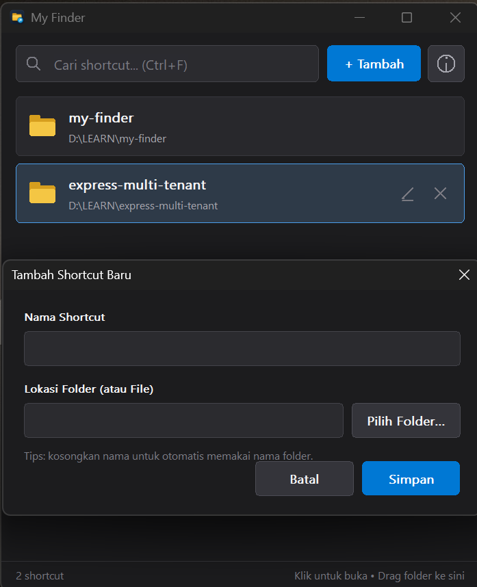

# My Finder

> *Dibuat dengan metode **vibe coding** bersama AI, lalu diuji dan dirawat secara terbuka sebagai proyek open source (MIT License).*

Aplikasi desktop Windows **super lightweight & ramah RAM** yang dibangun dengan **Go + Native Win32 GUI** (tanpa Electron, tanpa WebView2, tanpa runtime tambahan).



## Download
- **[Download `my-finder.exe` (Windows 64-bit, Versi Terbaru)](https://github.com/tegarla123-byte/my-finder/releases/latest/download/my-finder.exe)**
- [Halaman Releases, Changelog & SHA256 Checksum](https://github.com/tegarla123-byte/my-finder/releases/latest)

Tidak perlu instalasi — cukup unduh dan jalankan `my-finder.exe` langsung.

## Fitur Utama
- **Single-Click Open**: Klik item shortcut untuk langsung membuka **jendela File Explorer baru** (`explorer.exe /n`) ke folder tujuan.
- **Super Ringan**: Single file `.exe` portable (~2 MB), konsumsi RAM sangat rendah (~3–8 MB), startup instan.
- **Pencarian Cepat**: Ketik langsung untuk memfilter berdasarkan nama atau path (mendukung multi-kata).
- **Tema Adaptif**: Mengikuti Dark Mode / Light Mode Windows secara otomatis (termasuk title bar).
- **Folder Picker Modern**: Menambah/edit shortcut dengan pemilih folder bawaan Windows + dukungan **Drag & Drop** folder langsung ke jendela aplikasi.
- **Penyimpanan Portable**: Daftar shortcut tersimpan rapi di `shortcuts.json` di sebelah file `.exe`.

## Pintasan Keyboard
| Tombol | Aksi |
| --- | --- |
| `Ctrl+F` | Fokus ke kotak pencarian |
| `Ctrl+N` | Tambah shortcut baru |
| `↑` / `↓` | Pilih item di daftar |
| `Enter` | Buka item terpilih di File Explorer baru |
| `Alt+↑` / `Alt+↓` | Ubah urutan item |
| `Esc` | Bersihkan pencarian |
| `F1` | Buka dialog Tentang My Finder |

## Build Manual
```powershell
go build -ldflags="-H=windowsgui -s -w" -o my-finder.exe .
```

## Dokumentasi Lengkap
- [Portal Dokumentasi](docs/README.md)
- [Panduan Pengguna (Non-Teknis)](docs/panduan-pengguna.md)
- [Panduan Pengembangan (Development Guide)](docs/panduan-pengembangan.md)
- [Dokumentasi Teknis (Arsitektur & Developer)](docs/dokumentasi-teknis.md)
