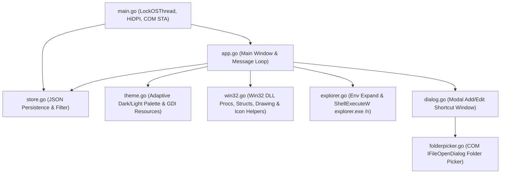

# Dokumentasi Teknis My Finder

Dokumen ini menjelaskan arsitektur perangkat lunak, struktur kode, pemanggilan Win32/COM API, strategi performa & memori, skema data, serta alur build dan pengujian untuk **My Finder**.

---

## 1. Ringkasan Arsitektur & Desain

My Finder dibangun dengan **Go (1.24+)** menggunakan **Pure Win32 API** (melalui `syscall.NewLazyDLL`) tanpa CGO, tanpa library pihak ketiga, dan tanpa browser engine (Electron/WebView2).

### Karakteristik Utama
- **Zero External Dependencies:** Hanya menggunakan Go standard library (`go.mod` tanpa `require`).
- **Zero CGO:** Tidak membutuhkan MinGW/GCC/MSVC untuk kompilasi; cukup `go build`.
- **Ukuran Binary:** ~2,34 MB (`-ldflags="-H=windowsgui -s -w"`).
- **Konsumsi Memori:** ~4,3 MB Private Working Set (Task Manager RAM).
- **Zero-Flicker Custom Canvas:** Seluruh jendela utama dan dialog di-render dengan GDI double-buffering (`CreateCompatibleDC` + `CreateCompatibleBitmap` + `BitBlt`), dikombinasikan dengan kontrol native `EDIT` untuk input teks & IME yang sempurna.

### Diagram Alur Komponen



---

## 2. Struktur File & Tanggung Jawab Modul

| File | Tanggung Jawab |
| --- | --- |
| `main.go` | Entry point: mengunci goroutine utama ke 1 OS thread (`runtime.LockOSThread`), mengaktifkan HiDPI Per-Monitor V2, menginisialisasi COM STA (`CoInitializeEx`), memuat `Store`, dan menjalankan event loop `App`. |
| `win32.go` | Definisi lazy-loaded DLL (`user32`, `gdi32`, `kernel32`, `shell32`, `dwmapi`, `ole32`, `advapi32`, `uxtheme`), konstanta/struct Win32, helper GDI (`drawRoundRect`, `drawText`, `createFont`), deteksi Dark Mode Windows, clipboard, dan pembuatan ikon aplikasi in-memory (`createAppIcon`). |
| `theme.go` | Definisi `Palette` (Dark & Light), cache GDI resources (`ThemeResources`: font Segoe UI & brush) dengan method `Destroy()` untuk mencegah GDI handle leak, serta helper skalasi DPI `S(px)`. |
| `app.go` | Jendela utama (`MyFinderMainWindow`), layout responsif, rendering daftar kartu shortcut yang ter-clip, scrollbar custom (wheel + drag), hit-testing, toast notification, drag & drop (`WM_DROPFILES`), context menu (`TrackPopupMenu`), dan subclassing kontrol `EDIT` pencarian (`searchEditWndProc`). |
| `dialog.go` | Dialog modal custom (`MyFinderShortcutDialog`) untuk Tambah & Edit shortcut dengan tema sinkron, tombol browse folder, validasi input, serta penanganan keyboard (`Enter`, `Esc`, `Tab`) di dalam nested message loop. |
| `about.go` | Dialog modal **Tentang My Finder** (`MyFinderAboutDialog`) menampilkan ikon aplikasi, versi (`main.appVersion`), informasi author, ringkasan MIT License, path `shortcuts.json`, serta tombol buka folder data. |
| `folderpicker.go` | Pemilih folder Windows modern melalui pemanggilan langsung COM vtable `IFileOpenDialog` (`FOS_PICKFOLDERS`) dan `IShellItem`. |
| `explorer.go` | Resolusi variabel environment Windows (`%VAR%`), pemeriksaan keberadaan path, dan peluncuran jendela File Explorer baru via `ShellExecuteW` ke `explorer.exe`. |
| `store.go` | Model `Shortcut`, deteksi lokasi file penyimpanan portable vs `%APPDATA%`, operasi CRUD + reorder, penyimpanan atomik (`.tmp` + rename), normalisasi path Windows, dan filter multi-token. |
| `store_test.go` | Unit test untuk `normalizePath`, `defaultNameForPath`, `resolvePath` (`%ENV%`), serta CRUD, persistence, filter multi-token, dan reorder pada `Store`. |

---

## 3. Detail Teknis Subsistem

### 3.1 Threading, HiDPI, dan COM STA
- **OS Thread Affinity:** Win32 GUI message queue dan COM Single-Threaded Apartment (STA) bersifat thread-affine. `main.go` memanggil `runtime.LockOSThread()` di awal eksekusi agar seluruh pemanggilan Win32 dan COM berjalan konsisten di thread OS yang sama.
- **Per-Monitor DPI Awareness V2:** `enablePerMonitorDPI()` memanggil `SetProcessDpiAwarenessContext((HANDLE)-4)`. Semua ukuran layout dan font dihitung dinamis melalui `theme.S(px) = (px * dpi + 48) / 96`. Saat jendela dipindah antar monitor dengan DPI berbeda, handler `WM_DPICHANGED` membuat ulang font/resource dan menerapkan ukuran jendela yang disarankan Windows.
- **COM STA:** `CoInitializeEx(0, COINIT_APARTMENTTHREADED | COINIT_DISABLE_OLE1DDE)` diinisialisasi sekali saat startup dan dibersihkan via `defer procCoUninitialize.Call()` saat keluar.

### 3.2 Rendering GUI & Disiplin Resource GDI
- **Double Buffering:** `WM_ERASEBKGND` mengembalikan `1` untuk mencegah flicker latar putih. Setiap `WM_PAINT` membuat offscreen memory DC (`CreateCompatibleDC` + `CreateCompatibleBitmap`), menggambar seluruh frame ke buffer, lalu menyalinnya sekaligus lewat `BitBlt(..., SRCCOPY)`.
- **Clipping Daftar:** Area daftar shortcut dibatasi dengan `CreateRectRgn` + `SelectClipRgn` sehingga kartu yang tergulir tidak pernah menimpa header maupun footer.
- **Ikon Aplikasi & Resource `.syso`:**
  - Ikon aplikasi multi-resolusi (`256, 64, 48, 32, 16` px) dibuat dengan generator vektor pure-Go di `tools/genicon/main.go` → menghasilkan `assets/icon.png`, `assets/icon.ico`, dan file Windows COFF resource `rsrc_windows_amd64.syso` (`RT_ICON` + `RT_GROUP_ICON` ID `1`) yang otomatis di-embed oleh `go build` ke `my-finder.exe`.
  - Jendela & taskbar memuat ikon yang sama melalui `loadAppIcon` (`LoadImageW` dari resource `.exe`, dengan fallback in-memory `createAppIcon`) dan dibersihkan via `DestroyIcon` saat keluar.
  - Ikon folder, kaca pembesar, edit, dan hapus di dalam UI digambar langsung menggunakan primitif GDI (`RoundRect`, `Ellipse`, `MoveToEx`, `LineTo`) agar selalu tajam di segala DPI.
- **Pencegahan Kebocoran GDI Handle:**
  - Brush dan font persisten disimpan di `ThemeResources` dan selalu dihapus dengan `DeleteObject` saat ganti tema/DPI atau keluar.
  - Pen/brush sementara dan offscreen DC/bitmap selalu di-`SelectObject` kembali ke objek lama dan di-`DeleteObject`/`DeleteDC` via `defer`.
- **Non-Blocking Paint:** `WM_PAINT` tidak pernah memanggil `os.Stat` atau I/O disk agar UI tidak pernah lag atau hang apabila ada shortcut yang mengarah ke network drive (`\\server\share`) yang sedang offline.

### 3.3 Subclassing Kotak Pencarian & Dialog Modal
- **Search Box (`searchEditWndProc`):** Kontrol native `EDIT` di-subclass dengan `SetWindowLongPtrW(GWLP_WNDPROC, ...)` untuk:
  - Meneruskan navigasi `↑`, `↓`, `Enter`, `Esc`, `Ctrl+F`, `Ctrl+N`, `Alt+↑/↓` langsung ke `App.handleKeyDown` tanpa menghilangkan fokus mengetik.
  - Menekan bunyi *beep* default Windows pada `WM_CHAR` untuk `Enter`/`Esc`/`Ctrl+F`/`Ctrl+N`.
  - Menggambar teks placeholder (`"Cari shortcut... (Ctrl+F)"`) saat panjang teks kontrol adalah `0`.
- **Modal Dialog (`dialog.go`):** Menonaktifkan jendela induk (`EnableWindow(parent, 0)`), menjalankan nested `GetMessageW` loop sampai `d.done == true`, lalu mengaktifkan dan memfokuskan kembali jendela induk sebelum menghancurkan jendela dialog.

### 3.4 Tema Adaptif (Dark / Light Mode)
- Membaca registry Windows:
  `HKCU\Software\Microsoft\Windows\CurrentVersion\Themes\Personalize` → `AppsUseLightTheme` (`0` = Dark, `1` = Light).
- Mengaktifkan title bar gelap native melalui `DwmSetWindowAttribute` dengan atribut `DWMWA_USE_IMMERSIVE_DARK_MODE` (`20`, fallback `19` untuk build Windows 10 lama).
- Mendengarkan pesan `WM_SETTINGCHANGE` di `mainWndProc` sehingga perubahan tema sistem langsung memperbarui palet, title bar, dan brush kontrol `EDIT` secara live.

### 3.5 Peluncuran File Explorer (`explorer.go`)
- Fungsi `resolvePath` mengekspansi variabel lingkungan gaya Windows (`%USERPROFILE%`, `%APPDATA%`, dll.) lalu menormalkan separator, tanda kutip, drive root (`D:` → `D:\`), dan prefix UNC (`\\server\share`).
- Menggunakan `ShellExecuteW(hwnd, "open", "explorer.exe", params, 0, SW_SHOWNORMAL)`:
  - **Direktori:** `params = /n,"<target>"` — memaksa Explorer membuka jendela baru langsung di dalam direktori tersebut.
  - **File:** `params = /n,/select,"<target>"` — membuka jendela baru dan langsung menyorot file tersebut.
- Menggunakan `ShellExecuteW` dengan string parameter mentah menghindari perilaku *argument escaping* milik `os/exec` yang sering merusak sintaks koma/kutip khas `explorer.exe`.

### 3.6 Native COM Folder Picker (`folderpicker.go`)
Menggunakan `CoCreateInstance` dengan `CLSID_FileOpenDialog` (`{DC1C5A9C-E88A-4dde-A5A1-60F82A20AEF7}`) dan `IID_IFileOpenDialog` (`{d57c7288-d4ad-4768-be02-9d969532d960}`):
- Vtable `IFileOpenDialog` yang dipanggil via `syscall.SyscallN`:
  - `[2]` `IUnknown::Release`
  - `[3]` `IModalWindow::Show`
  - `[9]` `IFileDialog::SetOptions` (`FOS_PICKFOLDERS | FOS_FORCEFILESYSTEM | FOS_PATHMUSTEXIST`)
  - `[10]` `IFileDialog::GetOptions`
  - `[12]` `IFileDialog::SetFolder` (opsional, memakai `SHCreateItemFromParsingName` jika path awal valid)
  - `[17]` `IFileDialog::SetTitle`
  - `[20]` `IFileDialog::GetResult` → `IShellItem`
- Vtable `IShellItem`:
  - `[2]` `Release`
  - `[5]` `GetDisplayName(SIGDN_FILESYSPATH, &pszPath)` → dibebaskan dengan `CoTaskMemFree`.
- Kode `HRESULT 0x800704C7` (`ERROR_CANCELLED`) ditangani sebagai pembatalan normal tanpa pesan error.

### 3.7 Penyimpanan Data & Skema JSON (`store.go`)
- **Resolusi Lokasi File (`defaultStorePath`):**
  1. Jika direktori executable bukan `os.TempDir()` (bukan `go run`) dan dapat ditulisi (`isDirWritable`), gunakan `<exeDir>\shortcuts.json` (mode portable).
  2. Jika tidak, fallback ke `%APPDATA%\MyFinder\shortcuts.json`.
- **Atomic Save:** Menulis ke `shortcuts.json.tmp` lalu melakukan `os.Rename` ke `shortcuts.json` (dengan fallback `os.WriteFile` jika file sedang dikunci sementara oleh antivirus Windows).
- **Skema JSON:**
  ```json
  {
    "shortcuts": [
      {
        "id": "a1b2c3d4e5f60708",
        "name": "My Finder",
        "path": "D:\\LEARN\\my-finder"
      }
    ]
  }
  ```
- **Algoritma Filter:** Input pencarian dipecah berdasarkan spasi (`strings.Fields`), lalu setiap token dicocokkan secara *case-insensitive* terhadap gabungan `Name + " " + Path` (logika AND antar token).

### 3.8 Keamanan `unsafe.Pointer` & Kepatuhan `go vet`
Pointer memori unmanaged yang berasal dari Windows API (`GlobalLock` untuk clipboard, `lParam` pada `WM_GETMINMAXINFO` dan `WM_DPICHANGED`) tidak di-cast langsung dari `uintptr` ke `unsafe.Pointer`. Sebagai gantinya, transfer struct/buffer dilakukan lewat `kernel32.dll!RtlMoveMemory`, sehingga kode 100% bersih terhadap analyzer `unsafeptr` milik `go vet`.

---

## 4. Pengembangan, Pengujian, dan Build

> Untuk panduan langkah demi langkah setup environment, cara menjalankan (`go run` vs debug/rilis), debugging GDI/RAM, dan troubleshooting, lihat **[Panduan Pengembangan (Development Guide)](./panduan-pengembangan.md)**.

### Prasyarat
- Windows 10 / 11 (x64)
- Go 1.24 atau lebih baru

### Menjalankan Analisis Statis & Unit Test
```powershell
go vet ./...
go test -v ./...
```

### Build Produksi (GUI Tanpa Konsol & Ukuran Minimal)
```powershell
go build -ldflags="-H=windowsgui -s -w" -o my-finder.exe .
```
Penjelasan flag:
- `-H=windowsgui`: Menetapkan subsystem Windows GUI agar tidak memunculkan jendela konsol/CMD.
- `-s -w`: Menghapus symbol table dan debug DWARF info untuk memperkecil ukuran binary.

### Build Debug (Dengan Konsol untuk Logging)
```powershell
go build -o my-finder-debug.exe .
```

---

## 5. Panduan Ekstensibilitas (Pengembangan Lanjutan)

Struktur kode saat ini dirancang modular agar fitur baru mudah ditambahkan tanpa menambah dependency berat:
- **System Tray Icon:** Tambahkan binding `Shell_NotifyIconW` (`shell32.dll`) di `win32.go`, tangani `WM_CLOSE` dengan `ShowWindow(hwnd, SW_HIDE)` bila mode tray aktif, dan tangani pesan callback tray di `mainWndProc`.
- **Global Hotkey:** Tambahkan `RegisterHotKey` / `UnregisterHotKey` (`user32.dll`) dan tangani `WM_HOTKEY` di `mainWndProc` untuk memunculkan/memfokuskan jendela dari mana saja.
- **Kategori / Grup Shortcut:** Tambahkan field ``Group string `json:"group,omitempty"` `` pada struct `Shortcut` di `store.go` (tetap kompatibel ke belakang dengan `shortcuts.json` lama), lalu tambahkan tab/filter grup di header `app.go`.
- **Always-on-Top Toggle:** Gunakan `SetWindowPos(hwnd, HWND_TOPMOST / HWND_NOTOPMOST, ..., SWP_NOMOVE|SWP_NOSIZE)`.
